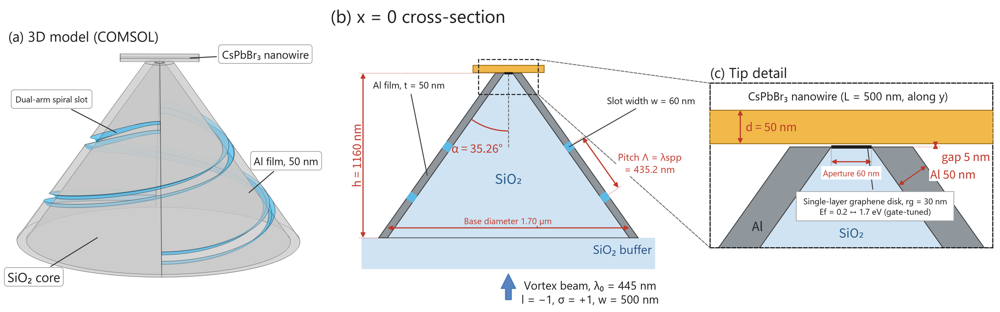
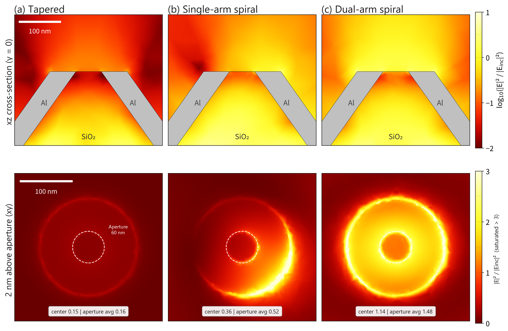
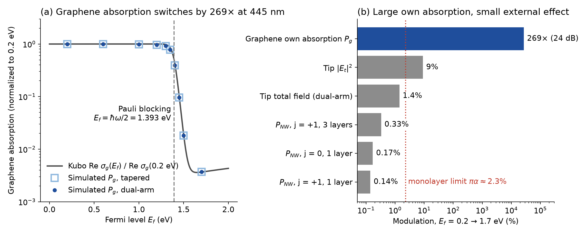

# Active near-field focusing probe: dual-arm spiral and graphene

3D full-wave COMSOL design study of a 60-nm-aperture near-field probe. A dual-arm spiral slot in the Al-coated
SiO₂ cone couples a 445-nm vortex beam into surface plasmons and focuses them on the tip. A gate-tuned graphene
disk sits on the aperture, and a CsPbBr₃ nanowire 5 nm above it is the absorption target. This is a simulation
study; no device has been fabricated.

Project page: <https://chiayu-max.github.io/active-near-field-probe/>

Presented as a poster at the 2026 Annual Meeting of the Taiwan Vacuum Society:
C.-Y. Lee, Y.-C. Wang, L.-L. Chung, "Design and Numerical Analysis of an Active Near-Field Focusing Probe
Integrating a Dual-Arm Spiral Metastructure and Graphene."

## Results

All values are at 445 nm with 1 W input, compared with a slot-free tapered probe of the same geometry, unless noted.

| Result | Value |
| --- | --- |
| Aperture-averaged intensity, dual-arm vs. tapered | 9.1× (1.48 vs. 0.163 of the incident intensity) |
| Same, band average over 400–500 nm | 10.6× (5.6–36× per wavelength; the peak comes from a dip in the tapered probe) |
| Nanowire absorption, dual-arm vs. tapered | 9.7× (1.31 vs. 0.135 mW) |
| Transverse field at the center, dual-arm | 0.30% of the total field, against 32% for a single arm |
| Center intensity contrast, j = 0 vs. j = −2 | about 160× |
| Graphene's own absorption, Ef = 0.2 → 1.7 eV | 269× (24 dB); Kubo model gives 272× |
| Graphene's effect on nanowire absorption | 0.14–0.33% |

- C₂ symmetry can change the total angular momentum j = l + σ only by ±2, and only j = 0 has an on-axis Ez. The
  dual-arm probe keeps this selection rule and adds the 9× gain. The single-arm probe gains less and loses it.
- Nanowire absorption stayed within ±5% for the tested geometry changes. The range is not symmetric for every
  parameter: pitch was tested at 0.90 and 1.04 λspp, and the graphene radius only at 27 nm
  (`data/tolerance_P_NW.csv`).
- The graphene result is a limit, not a working modulator. Pauli blocking switches graphene's own absorption
  strongly, but a monolayer absorbs at most πα ≈ 2.3% and interacts only with the in-plane field, while the tip
  field is mostly Ez. Resonant or gap-plasmon structures would be needed to amplify the modulation.

## Method

COMSOL Multiphysics 6.1, frequency-domain electromagnetic waves, full 3D model (no mirror symmetry is available),
about 2.2 million degrees of freedom, direct solver (PARDISO), about 20 minutes per run.

- **Source:** l = −1, σ = +1 vortex beam, waist 500 nm, from an internal port. A bottom PML absorbs reflections so
  no false cavity forms between the port and the tip.
- **Materials:** SiO₂ from Malitson; CsPbBr₃ n, k from Brennan et al.; Al from McPeak et al. through an impedance
  boundary condition; graphene as a Kubo surface conductivity (300 K, τ = 50 fs).
- **Mesh:** air λ/4, SiO₂ λ/(5n), tip 10 nm, nanowire 12 nm, four swept PML layers.

Checks (`data/verification.csv`):

| Check | Result |
| --- | --- |
| Tip mesh 10 → 6 nm | center field < 0.2%, aperture average −2.5%, dual-arm/tapered ratio 9.09 → 9.01 |
| Mesh with nanowire (tip 6 nm, wire 8 nm) | nanowire absorption and center field < 0.3% |
| Repeat run, same settings | about 1% |
| Graphene absorption on two meshes | absolute values differ by about 10%, ratio < 2%, so only ratios are reported |
| Kubo conductivity, computed separately | 272×, against 269× simulated |
| Incident peak field, analytic | 2.19×10⁷ V/m, matching the model |

## Limitations

- The Al tip is modeled with sharp edges, and CsPbBr₃ birefringence is not included.
- Ef = 1.7 eV is a very high doping level and would need ionic-liquid gating or similar.
- The impedance boundary replaces the 50-nm Al volume, so no field inside the metal is resolved.
- No experiment has tested these numbers.

The numbers here replace those in the conference abstract (425 nm, 1.45 eV threshold), which came from an earlier
model. The poster and this repository use 445 nm and a threshold of 1.393 eV.

## Repository

| Path | Contents |
| --- | --- |
| `index.html` | Project page |
| `data/` | Parameters, results and checks as CSV |
| `figures/` | Figures 1–8 |
| `scripts/plot_figures.py` | Redraws figures 4, 6 and 8 from `data/`; computes the Kubo and incident-field checks |

To redraw: `pip install numpy matplotlib`, then `python scripts/plot_figures.py`.

Figures 1, 2, 3, 5 and 7 come from the poster with the labels changed to English. Their field maps are the original
COMSOL exports. The simulated points in `data/graphene_absorption_vs_Ef.csv` were read back from the vector graphics
in the poster PDF. The `.mph` models (up to 2 GB each) and the CsPbBr₃ n, k tables are not included.

## Credits

Research led by Chia-Yu Lee at Chung Yuan Christian University, with co-authors Yu-Cheng Wang and Li-Lun Chung. The
project began under Prof. Pi-Ju Cheng. Claude (Anthropic) helped write the poster text and organize this repository:
the data tables, English figure labels, redrawn figures, Kubo and incident-field scripts, this README and the project
page.

Copyright is retained by the authors. Please cite the poster when using these results.

## References

1. M. C. Brennan et al., *MRS Commun.* **14**(5), 900–908 (2024). [doi:10.1557/s43579-024-00576-x](https://doi.org/10.1557/s43579-024-00576-x)
2. I. H. Malitson, *J. Opt. Soc. Am.* **55**(10), 1205 (1965). [doi:10.1364/JOSA.55.001205](https://doi.org/10.1364/JOSA.55.001205)
3. K. M. McPeak et al., *ACS Photonics* **2**, 326–333 (2015). [doi:10.1021/ph5004237](https://doi.org/10.1021/ph5004237)
4. G. W. Hanson, *J. Appl. Phys.* **103**(6), 064302 (2008). [doi:10.1063/1.2891452](https://doi.org/10.1063/1.2891452)
5. L. A. Falkovsky, *J. Phys.: Conf. Ser.* **129**, 012004 (2008). [doi:10.1088/1742-6596/129/1/012004](https://doi.org/10.1088/1742-6596/129/1/012004)
6. R. R. Nair et al., *Science* **320**(5881), 1308 (2008). [doi:10.1126/science.1156965](https://doi.org/10.1126/science.1156965)
7. G. Ermolaev et al., *Nano Lett.* **23**(7), 2570–2577 (2023). [doi:10.1021/acs.nanolett.2c04792](https://doi.org/10.1021/acs.nanolett.2c04792)
